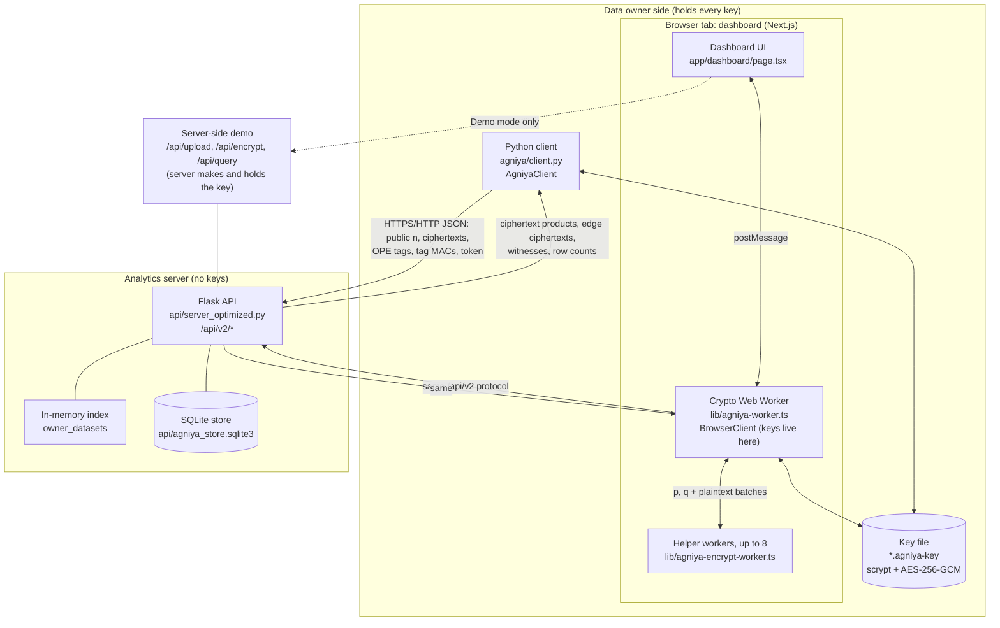
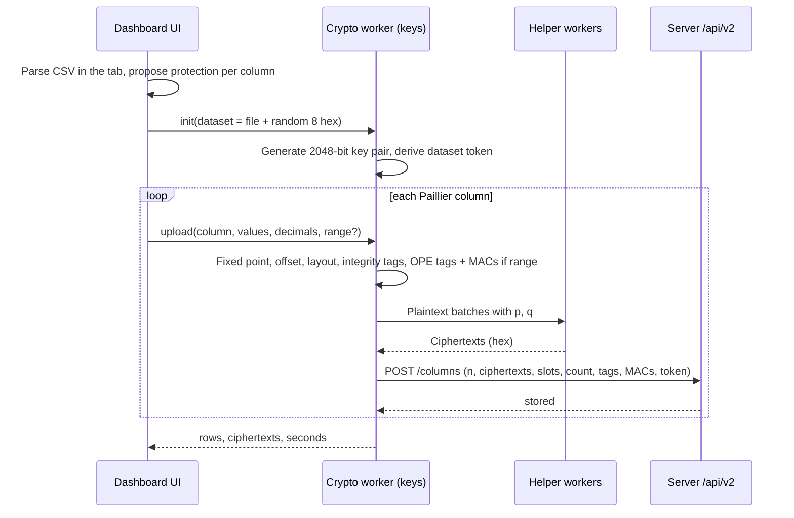
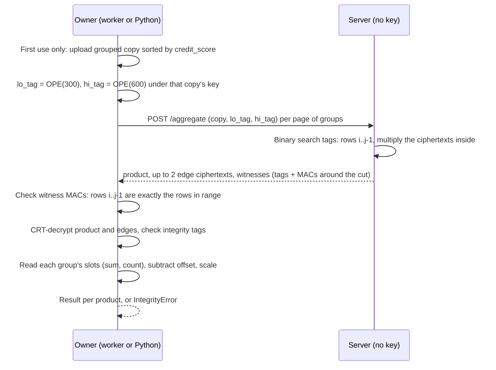

# AGNIYA system architecture

> This describes the system as it runs today (branch `integrity`, commit `91435b2`), not a target design. Every component, endpoint, limit and number here is taken from the code, the tests or `tools/bench_results.json`. Section 11 lists what a bank deployment still needs.

**Status labels used below**

| Label | Meaning |
|---|---|
| **Core** | On the privacy path: keys stay with the data owner, the server sees only ciphertexts. This is the system to build on. |
| **Demo** | Works and is tested, but the server holds the key. Kept for speed comparisons only. |
| **Legacy** | Earlier research code, tested, not used by the client, server or dashboard. |

---

## 1. What the system does

A data owner (a bank, or an analyst's browser tab) encrypts numeric columns with 2048-bit Paillier, packs 48 to 73 values into each ciphertext, and uploads only ciphertexts to an analytics server. The server answers SUM, COUNT, AVG, VARIANCE, STDDEV, MIN, MAX, MEDIAN and any quantile, with range filters and GROUP BY on one or two columns, by multiplying and selecting ciphertexts. It never holds a key. The data owner decrypts only the totals and checks each answer against integrity tags the server cannot forge, so a wrong, partial or replayed answer raises an error instead of returning a wrong number.

## 2. System context



Both clients speak the same `/api/v2` protocol and produce byte-compatible data: a dataset encrypted in the browser can be queried from Python and the reverse, and a key file saved by either opens in the other (`tests/test_integration/test_browser_crypto.py`).

## 3. Components

| Component | Location | Runs on | Role | Holds keys | Status |
|---|---|---|---|---|---|
| Paillier core | `agniya/core/paillier.py`, `number_theory.py` | Python | Key generation (safe primes, `n` of exactly 2048 bits), encryption, CRT decryption, homomorphic add | n/a | Core |
| Fast randomness | `agniya/core/djn.py`, `precomputation.py` | Python | `r^n` by DJN fixed-base short exponent (default, `AGNIYA_RN_METHOD=djn`), pool refilled in parallel processes | n/a | Core |
| Packing and query maths | `agniya/core/batch_packing.py` | Python | `BatchedAggregator`: slot layout, column/group/sorted-group packing, `range_plan` (server half), `decrypt_range`/`decrypt_groups` (owner half), quantile rows, variance | n/a | Core |
| Integrity | `agniya/core/integrity.py` | Python | `ColumnMac`: tags inside every plaintext, HMAC of OPE tags per ciphertext, range-cut checks | n/a | Core |
| Order-preserving tags | `agniya/hybrid/fast_ope.py` (+ `pyope`) | Python | Boldyreva OPE, bit-identical to `pyope`, many values per tree walk | n/a | Core |
| Python client | `agniya/client.py` | Bank side | `AgniyaClient`: upload, query, quantiles, GROUP BY, key files, dataset token | **Yes** | Core |
| Browser client | `webapp/lib/agniya-browser.ts` | Browser Web Worker | TypeScript port of all of the above with BigInt; `BrowserClient` | **Yes** (inside the worker) | Core |
| Worker plumbing | `webapp/lib/agniya-worker.ts`, `agniya-worker-client.ts`, `agniya-encrypt-worker.ts` | Browser | Request/response over `postMessage`; batches of 4 × helpers or more are split across `min(8, cores - 1)` helper workers, else encrypted in the worker | Yes (worker and its helpers) | Core |
| Analytics server | `api/server_optimized.py` (`/api/v2/*`) | Server | Stores ciphertexts and tags, answers aggregates, quantiles, ranges, ciphertext lookups; token check; store limit | **No** | Core |
| Dashboard | `webapp/app/dashboard/page.tsx` | Browser | Four steps (Load data, Choose protection, Ask questions, Log), six bank questions, query builder, key file save/restore | No (talks to the worker) | Core |
| Home page | `webapp/app/page.tsx`, `components/live-slip.tsx` | Browser | Product page; live slip encrypts three synthetic rows with a published demo key | Demo key only | Core (presentation) |
| Server-side demo | `api/server_optimized.py` (`/api/upload`, `/api/encrypt`, `/api/query`), `agniya/core/ultimate_system.py`, `webapp/lib/api.ts` | Server | CSV uploaded in plaintext; server makes one key at start-up and holds it; datasets kept in memory only | **Server holds key** | Demo |
| Hybrid AES storage | `agniya/hybrid/aes_cipher.py`, `key_wrapper.py`, `schema.py`, `hybrid_storage.py`; `examples/`, `scripts/` | Python | Earlier AES-plus-Paillier record store and its benchmarks | n/a | Legacy |
| Benchmarks | `tools/bench.py` → `tools/bench_results.json`; `tools/verify_claims.py` | Python | Reproducible measurements, each result checked exact; SEAL (TenSEAL) baseline and cross-check | n/a | Tooling |
| Data | `tools/make_bank_data.py` → `data/bank_customers.csv` | Python | 2,000 synthetic customers, seed 2026 | n/a | Tooling |

## 4. Trust boundaries and key custody

| Secret or artifact | Where it lives | Who can read it |
|---|---|---|
| Paillier primes `p`, `q` (private key) | Python client object; browser: the crypto worker and the helper workers it starts (they receive `p`, `q` with each batch and end with the crypto worker, when the tab closes or the data is re-encrypted) | Data owner only |
| Per-column integrity key (32 bytes, `ColumnMac`) | Client / worker; key file | Data owner only |
| Per-column OPE keys | Client / worker; key file | Data owner only |
| Plaintext values and GROUP BY labels | Client / worker memory; never uploaded on the `/api/v2` path | Data owner only |
| Key file `*.agniya-key` | Owner's disk | Anyone with the file **and** its password (scrypt N=2^17, r=8, p=1; AES-256-GCM) |
| Dataset token `SHA-256("agniya/v2 dataset token\0" + min(p,q) + "\0" + dataset)` | Sent in every `/api/v2` request body | Owner; the server stores only its SHA-256 |
| Public modulus `n`, packed ciphertexts, slots, row counts | Server memory and SQLite | Server |
| OPE tags (64-bit, sorted) and tag MACs (16 bytes per ciphertext) | Server, only for columns marked "Paillier + range" | Server (learns the order of those columns) |

> **Boundary rule:** everything that crosses to the server is either public (`n`), a ciphertext, an OPE tag on an opted-in column, a MAC, a count, or the token. The server's answers are ciphertexts plus row indices, and none of them is trusted until the owner's checks pass.

## 5. Data model

### 5.1 Encoding a column

1. **Fixed point.** Integers stay as they are; decimals are scaled by 10^4 (`FIXED_POINT_DECIMALS = 4`, browser `decimals = 4`), so sums are exact integers.
2. **Offset.** If a column has negative values, its minimum is subtracted from every value (`offset = min(0, min(values))`), so every slot is non-negative. The owner keeps the offset in the column layout (and key file) and adds `offset × count` back after decryption. Non-negative columns are not shifted.
3. **Slot layout.** `BatchedAggregator.layout(max_value, count)` picks `slots` and `slot_bits` so that the sum of all `count` values in one slot cannot overflow into the next: usable bits = `bits(n) - 1 - 159` (1,888 for a 2048-bit key). That gives **48 to 73 values per ciphertext** on the data used here.
4. **Integrity tag.** The top 159 bits (`RESERVE`) of every plaintext hold `t = (α·m + β(page, c)) mod (2^127 − 1)`, with α and each β drawn from an AES-256-CTR keystream under the column's integrity key. Tags add up under multiplication exactly like the data.
5. **Encryption.** `c = (1 + m·n) · r^n mod n²`, fresh `r^n` per ciphertext (DJN fixed base in Python; CRT in the browser).

### 5.2 Column copies

Some queries need the same column packed in a different order. Each copy is an ordinary stored column with a reserved name, built on first use and then reused (the dashboard reports the build time as "one-time setup"; answers are never cached).

| Stored name | Contents | Enables |
|---|---|---|
| `a` | Column `a`; sorted by value and OPE-tagged if marked "range" | SUM/COUNT/AVG; ranges, MIN/MAX/MEDIAN on `a` |
| `a\|b` | `a` packed in `b`'s sorted order, with `b`'s OPE tags | `SUM(a) WHERE b BETWEEN …` |
| `a#g` (pages `a#g@1`, …) | `a` packed so each group of `g` owns its own slots | GROUP BY `g` with one decryption per page |
| `a#g\|w` | Grouped copy sorted by `w`, with `w`'s OPE tags | GROUP BY `g` WHERE `w` in a range |
| `a^2`, `a#g^2`, … | `(x − c)²` per row, `c` about the mean | VARIANCE / STDDEV next to the matching SUM |
| `a#g^sorted` (and `…\|w`) | `a` sorted within each group | MIN / MAX / MEDIAN / quantiles per group |
| `a#g,h` | Grouped by the pair label `"x, y"` | GROUP BY two columns (up to 64 combinations) |

### 5.3 Server store

SQLite at `AGNIYA_STORE` (default `api/agniya_store.sqlite3`):

```sql
columns(dataset TEXT, name TEXT, n TEXT, slots INTEGER, count INTEGER,
        cts BLOB, tags BLOB, macs BLOB, PRIMARY KEY (dataset, name))
owners(dataset TEXT PRIMARY KEY, token_hash TEXT)
```

Ciphertexts are fixed-width big-endian blobs (`bits(n²)/8` bytes each), tags 8 bytes, MACs 16 bytes. Writes commit before the server answers. At start-up `load_store()` reads **every** stored column into memory (`owner_datasets`), which is fast for the sizes tested and is the first thing to change for scale (section 11). Total stored bytes are capped by `AGNIYA_STORE_MAX_MB` (default 1024); over the cap a write gets HTTP 507.

## 6. API

All `/api/v2` bodies are JSON and carry `dataset` and `token`. A new dataset is claimed by its first token; afterwards a missing token gets **401** and a wrong one **403**.

| Endpoint | Request (main fields) | Response | Limits and checks |
|---|---|---|---|
| `POST /api/v2/columns` | `dataset, column, n` (hex), `ciphertexts` (hex), `slots, count`, optional `ope_tags` (sorted), `tag_macs` | stored counts | `n` odd and ≥ 2048 bits; every ciphertext in (0, n²); count consistent with slots; tags sorted 64-bit; one MAC per ciphertext; same `n` for the whole dataset (409); store cap (507) |
| `POST /api/v2/aggregate` | `dataset, column`, optional `lo_tag, hi_tag` | `product` (hex), `edges` (at most 2 cut ciphertexts with slot ranges), `rows [i, j]`, `witnesses`, `ciphertexts_used`, `time_ms` | Range by binary search over sorted tags |
| `POST /api/v2/quantiles` | `dataset, column, q` (1 to 101 values in [0, 1]), optional range | ciphertexts holding the quantile rows (pandas linear interpolation), `rows`, `witnesses` | Column must be OPE-tagged |
| `POST /api/v2/ranges` | `dataset, column, ranges` (1 to 1,024 `{lo_tag, hi_tag}`) | `rows` and `witnesses` per range | Used for per-group ranges in sorted-within-group copies |
| `POST /api/v2/ciphertexts` | `dataset, column, index` (1 to 4,096) | the stored ciphertexts | Used for per-group quantile cells |
| `POST /api/v2/delete` | `dataset` | columns deleted | Token required |
| `GET /api/health` | | status and feature flags | |
| `POST /api/upload`, `/api/encrypt`, `/api/query`, `GET /api/databases` | Demo mode: plaintext CSV in, server-held key | results | **Demo** (server is the data owner; in memory only) |

Operational settings: `AGNIYA_HOST` (default `127.0.0.1`), port 5000, `AGNIYA_CORS_ORIGINS` (default `http://localhost:3000`), `AGNIYA_DEBUG=1` only for local debugging, request body cap 100 MB.

## 7. Key flows

### 7.1 Encrypt and upload (browser, the demo path)



The dataset name gets a random suffix so two runs of the same file never collide. Copies for GROUP BY, cross-column ranges, squares and sorted groups are uploaded later, on first use.

### 7.2 Query: `SUM(loan_amount) WHERE credit_score BETWEEN 300 AND 600 GROUP BY product`



Other operations follow the same pattern:

| Operation | Server does | Owner decrypts |
|---|---|---|
| SUM / COUNT / AVG | One product over the column (or range) | 1 product + ≤ 2 edges |
| GROUP BY | One product per page of groups | 1 per page (+ edges with a range) |
| VARIANCE / STDDEV | Products over the column and its `^2` copy | 2, then `(n·S2 − (S1 − n·c)²) / (n(n−1))` |
| MIN / MAX / MEDIAN / quantile | Returns the 1 or 2 ciphertexts holding the quantile rows | 1 to 2 ciphertexts, one slot each |
| Quantile per group | Ranges per group, then the cells' ciphertexts | 1 to 2 per group |
| COUNT (no filter, demo) | Returns the stored row count | nothing |

### 7.3 Key file and session restore

`save(password)` writes the primes, every column's integrity and OPE keys and layouts as JSON, encrypted with AES-256-GCM under a scrypt-derived key (`format: agniya-client-key/1`). `load` (Python) or "Reopen a saved session" (dashboard) rebuilds the client, recomputes the token and reattaches to the ciphertexts already on the server. Without the key file, closing the tab makes the uploaded data undecryptable.

## 8. What each party learns

| | Learns | Does not learn |
|---|---|---|
| Server | Row counts; ciphertext sizes; the order of values in columns marked "range"; which slots line up between a column and its copies; which stored ciphertexts a median or quantile reads | Any value, label, key, or a way to change an answer unnoticed |
| Owner, beyond the answer | The other values packed in an edge ciphertext of a range, or in a quantile's ciphertext | n/a |
| Anyone with the token but no key | Ciphertexts and answers in encrypted form | Values |

> Guarantees and assumptions: IND-CPA under decisional composite residuosity (2048-bit keys, about 112-bit security); integrity forgeries succeed with probability about 2^−127 (AES-256 keystream, HMAC-SHA256). Not provided: post-quantum security, protection of the order of range columns, availability against a server that refuses to answer, and an independent security review.

## 9. Performance (measured, not projected)

Intel i5-1145G7 laptop, 16 GB, 2048-bit keys, `tools/bench.py`, every answer checked exact against plaintext:

| Measure | Value |
|---|---|
| Encrypt 1,000,000 values (all cores) | 6.39 s, 6.4 µs per value |
| SUM over 1,000,000 encrypted values | 130 ms |
| Encrypt / SUM 10,000,000 values | 57.3 s / 1.32 s |
| Storage | 7 to 11 bytes per value |
| GROUP BY region, 1,338 rows | 3.5 ms (server-side) / 3.9 ms (keys on the client) |
| MEDIAN with a range, 706 rows | about 6 ms |
| `r^n`: DJN fixed base vs standard | 0.68 ms vs 11.6 ms |
| CRT decryption of one product | 3.27 ms |
| Microsoft SEAL (BFV), same laptop | encrypt 1.1 µs per value; GROUP BY 478 ms; ≥ 53 bytes per value; identical totals |
| Browser, 2,000 bank customers | encrypt 3.5 s; each bank question 0.2 to 0.4 s; first use builds its copy in 0.3 to 1.5 s |

Where time goes: encryption cost is `r^n` (hence DJN and the helper workers); query cost is one modular multiplication per ciphertext on the server plus one CRT decryption per product on the owner side; copy building costs as much as encrypting the column once.

## 10. Build, run, test

| Task | Command or file |
|---|---|
| Run locally | `.\start.ps1`: API on 127.0.0.1:5000, dashboard on localhost:3000, waits for both |
| Python environment | `envb` virtualenv; `requirements.txt`; package via `pyproject.toml` (Apache-2.0) |
| Webapp | Next.js 16, React 19, TypeScript, Tailwind v4; fonts self-hosted by `next/font` (first run needs internet) |
| CI | `.github/workflows/ci.yml`: Python 3.12 + Node 22; `tsc`, `eslint`, `pytest` (benchmark-only packages left out) |
| Tests (319) | `tests/test_core` (Paillier, DJN, packing, OPE), `tests/test_integration/test_client_split.py` (client + server, tampering), `test_api.py` (every query against pandas), `test_browser_crypto.py` (TypeScript and Python read each other's data and key files), `test_seal_crosscheck.py` (SEAL totals), `tests/test_hybrid` (legacy) |
| Benchmarks | `python tools/bench.py --sizes 1000,10000,100000,1000000` on AC power; results in `tools/bench_results.json` |
| Demo data | `python tools/make_bank_data.py` → `data/bank_customers.csv` |

## 11. Limits today and the path forward

The cryptography, protocol and checks are the stable core. What stands between this and a bank deployment is mostly around them:

| Area | Today | Next step | Rough effort |
|---|---|---|---|
| Server runtime | Flask development server, one process, plain HTTP on localhost | WSGI server (gunicorn/waitress) behind TLS; health and metrics | days |
| Server memory | Whole store loaded into RAM at start | Load columns lazily from SQLite or Postgres; stream products | 1 to 2 weeks |
| Scale-out | Single node; tested to 10 million values | Shard columns by ciphertext range; products combine across shards (multiplication is associative) | 4 to 6 weeks |
| Keys | Password-protected key files | Keys in the bank's HSM or KMS; envelope-encrypt the key file | 2 to 4 weeks |
| Identity and access | One bearer token per dataset | SSO, per-user roles, per-dataset permissions; tokens out of request bodies into headers | 2 to 3 weeks |
| Audit | None | Tamper-evident log of who ran which query | 1 to 2 weeks |
| Data changes | Re-upload a column to change it | Append ciphertext pages; recompute copies incrementally | 2 to 3 weeks |
| Leakage | OPE reveals order on range columns | Comparisons without OPE (scheme switching) for sensitive columns | research |
| Post-quantum | Paillier is not | Pluggable BFV backend (SEAL or OpenFHE), already cross-checked for SUM and GROUP BY | research |
| Multi-party | One owner per dataset | Threshold decryption for joint statistics across institutions | research |
| Clean-up | `agniya/hybrid/{aes_cipher,key_wrapper,schema,hybrid_storage}.py`, `examples/`, `scripts/` unused by the product | Move to `legacy/` or delete with their tests | hours |

> **Recommended order:** server runtime and TLS, then lazy loading, then KMS-held keys and roles. Those three turn the current single-laptop demo into something a bank can pilot (see the six-week plan in `docs/BANKING.md`) without touching the cryptographic core.
